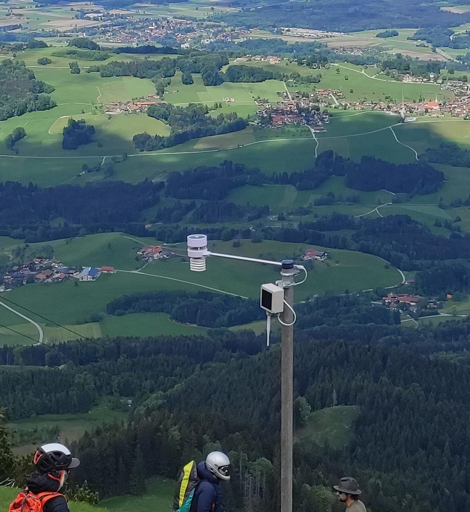
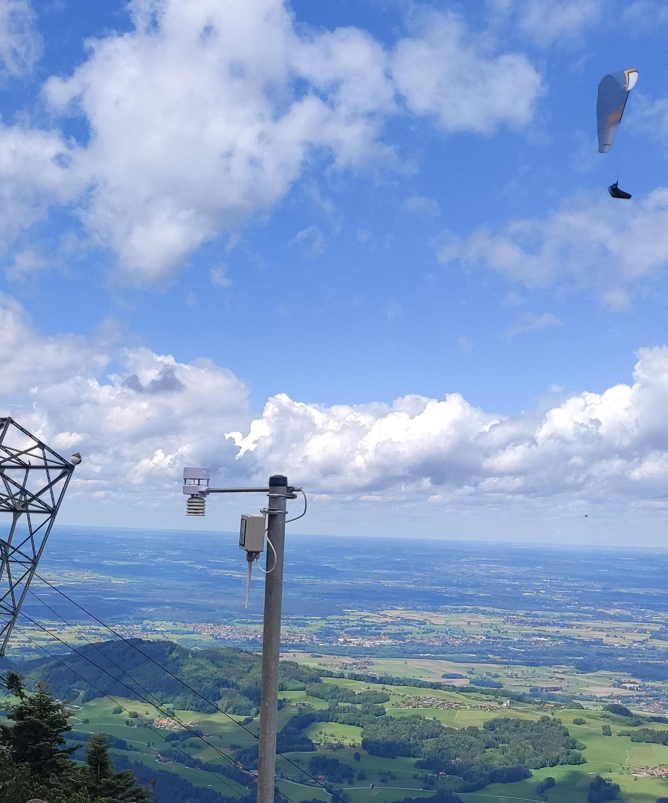

# Breezedude Wind Station
### An open source, solar powered FANET wind station for paragliding and hang gliding sites

The Breezedude measures wind speed, gusts, wind direction, temperature and air
pressure at your launch or landing site and sends them over FANET, a free radio
network. FANET varios nearby show the data directly, and every ground station in
range passes it on to the internet, where it appears on the
[Breezedude map](https://breezedude.de/) and on the OGN. No SIM card, no
subscription: a small solar panel and a battery keep it running.

  
   
  

## Where to start

**[install.breezedude.de](https://install.breezedude.de/) is the place for
everything you need to set up and run a station** (in German). You do not need
anything from this repository for that.

| You want to | Go to |
|---|---|
| Find out whether a ground station covers your site | [Ground station map](https://gsmap.breezedude.de) and the [FAQ](https://install.breezedude.de/faq.html) |
| Buy a complete set or the parts | [Where to buy](https://install.breezedude.de/where-to-buy.html) |
| Assemble and mount the station | [Setup guide](https://install.breezedude.de/setting-up-a-breezedude.html) |
| Set the name, position and sensor | [Configurator](https://install.breezedude.de/configurator.html): it writes the `settings.txt` for you |
| See what the station is doing, find faults | [USB diagnosis](https://install.breezedude.de/tools/breezedude-analyze.html) in Chrome or Edge |
| Update the firmware | [Software update](https://install.breezedude.de/tools/breezedude-update.html) |
| Build a ground station of your own | [Ground station](https://install.breezedude.de/groundstation.html) and [BreezedudeGS](https://github.com/Breezedude/breezedudeGS) |
| Read about hardware versions, repeaters and compatibility | [Wind station](https://install.breezedude.de/windstation.html) |
| Manage your stations, configure and update them over the air | [Device management](https://devices.breezedude.de/) |

## Questions, problems, ideas

**Ask in the [Discussions](https://github.com/Breezedude/breezedudeWindSensor/discussions).**
Other station owners read along there, and many questions have been answered
before, so a quick search often helps. When you ask about a station, the most
useful details are:

- the station ID (for example `BD1234`) and its firmware version, both shown by the
  [USB diagnosis](https://install.breezedude.de/tools/breezedude-analyze.html)
- the wind sensor you use
- what the LEDs do: blue blinks when the station sends, red means it found a problem
- the log from the USB diagnosis, if the station does not behave as expected

## How it works

1. The wind sensor on the mast measures, the Breezedude transmitter in the box
   below it reads the sensor and averages the values.
2. Every 40 seconds the station sends wind, gusts, direction, temperature and
   pressure over FANET on 868 MHz.
3. FANET varios in the air receive the packets directly. A ground station in range
   forwards them to the OGN and to [breezedude.de](https://breezedude.de/).

With a clear line of sight a ground station 30 km away and more is no problem.
Behind trees, buildings or a ridge the range can drop to a few kilometres. For a
station hidden behind a mountain, a second Breezedude on the summit can work as a
**repeater** and pass its packets on. The
[wind station page](https://install.breezedude.de/windstation.html#reichweite)
explains the repeater modes; the scheduled repeater only switches its receiver on
when a packet is due and gets by on very little power.

## What is in the box

- **Transmitter board** with a SAMD21 microcontroller, USB-C, SMA antenna connector
  and charging for a 1S Li-Ion battery (16340) from a 5 V solar panel
- **LoRa module LLCC68** for FANET on 868 MHz
- **Barometer HP203B** for pressure and temperature

Supported wind sensors:

- **Ecowitt WS85** in UART mode: recommended, best supported, part of the complete set
- **Davis 6410**: analog anemometer with reed contact and potentiometer
- **Ecowitt WS80**: works, but needs more adaptation

Power use averaged over the 40 s send interval, measured on the bench at the
battery: about 0.3 mA with a Davis 6410 and about 0.8 mA with a WS85.

## Firmware updates

Stations within reach of a Breezedude ground station can be updated over the air,
and their settings can be changed remotely in the
[device management](https://devices.breezedude.de/). Otherwise connect the station
by USB and follow the [update guide](https://install.breezedude.de/tools/breezedude-update.html).
Firmware releases are published on the
[releases page](https://github.com/Breezedude/breezedudeWindSensor/releases).

## For developers

- Firmware: PlatformIO, Adafruit SAMD core and the ItsyBitsy M0 variant definitions.
  `pio run` builds `build/ota/breezedude-ota-<version>.bin` and a UF2 image.
- Host tests for the logic that runs without hardware: `testing/host/run_all.bat`
  (needs Visual Studio's `cl.exe`).
- The HWInfo radio report is described in [doc/hwinfo-protocol.md](doc/hwinfo-protocol.md).
- Hardware: [breezedudeWindSensor-pcb](https://github.com/Breezedude/breezedudeWindSensor-pcb)
- Bootloader: [bootloader_samd21_breezedude](https://github.com/Breezedude/bootloader_samd21_breezedude)
- [Wiki](https://github.com/Breezedude/breezedudeWindSensor/wiki)

#### Related projects and inspiration
* https://github.com/gereic/GXAirCom
* https://github.com/jgromes/RadioLib
* https://github.com/3s1d/fanet-stm32
* https://github.com/adafruit/ArduinoCore-samd and https://github.com/adafruit/uf2-samdx1

## License

Hardware and software are licensed for non-commercial use only, see [LICENSE.txt](LICENSE.txt).

If you like this project

